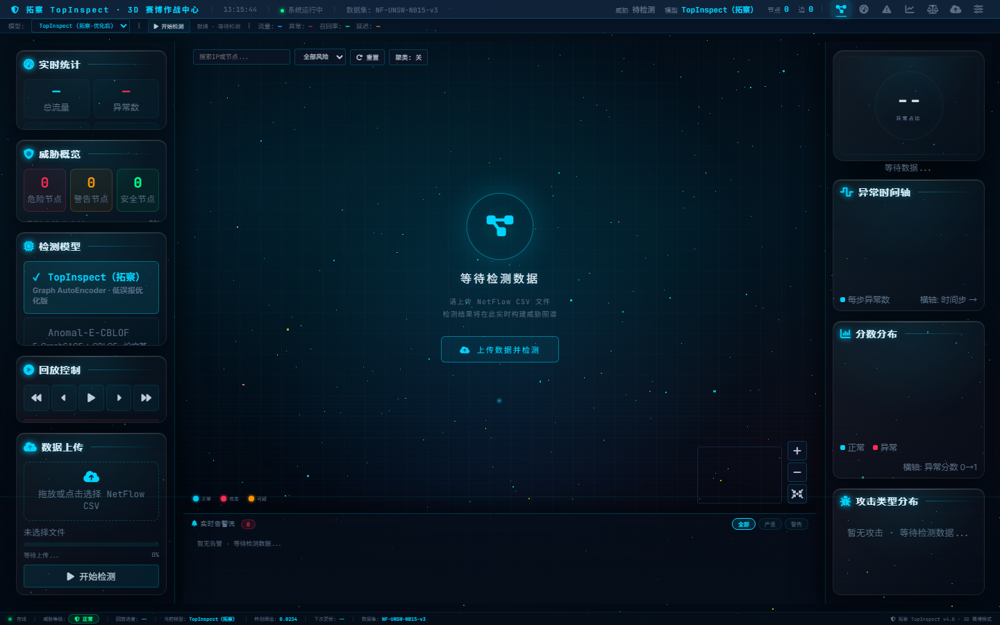
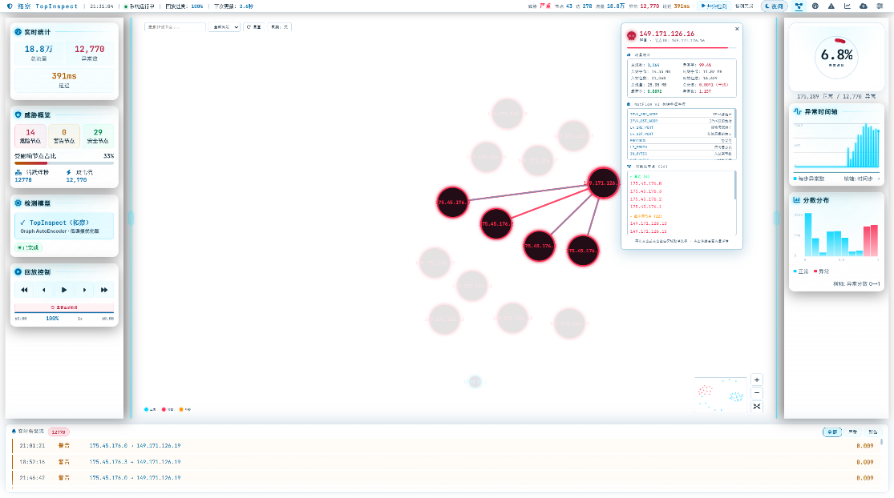
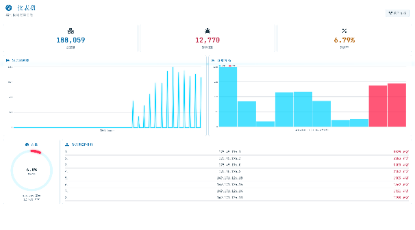
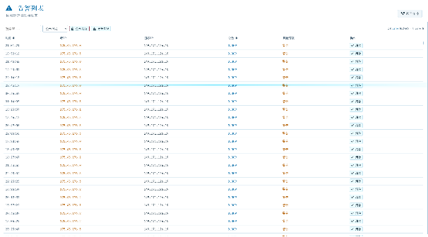
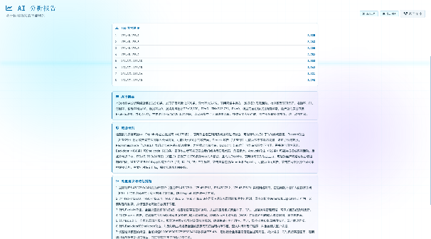
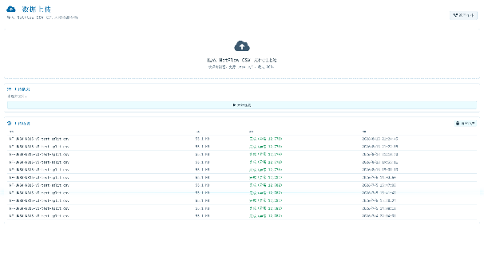
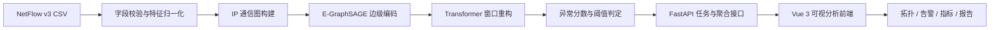

<div align="center">

# TopInspect · 拓察

### 基于自监督图学习的网络入侵检测与可视分析平台

[](https://www.python.org/)
[](https://fastapi.tiangolo.com/)
[](https://vuejs.org/)
[](https://pytorch.org/)
[](LICENSE)

将 NetFlow 网络流量建模为“主机—通信”图，结合 E-GraphSAGE 与 Transformer
自编码器进行无监督异常检测，并通过拓扑、告警、指标和分析报告形成可交互的研判闭环。

</div>



## 产品能力

| 能力 | 说明 |
| --- | --- |
| 图结构异常检测 | 以 IP 为节点、网络流为边，学习正常通信模式并输出逐流异常分数 |
| 可视化拓扑 | 动态展示通信关系、异常边、高风险节点与节点详情 |
| 检测任务与回放 | 上传 NetFlow v3 CSV，异步执行推理，通过 SSE 返回进度并按时间轴回放 |
| 告警研判 | 聚合异常流量、攻击类型、源/目标 IP 与关键流量特征 |
| 模型对比 | 对比 TopInspect、优化前模型与 Anomal-E-CBLOF 基线 |
| 分析报告 | 根据真实检测指标生成结构化报告；配置 DeepSeek 后可启用 AI 研判文字 |

> 当前开源版本面向 **NetFlow CSV 批量推理与结果回放**。持续抓包、镜像口实时接入和生产环境权限体系不在本仓库范围内。

## 界面展示

下图来自信安赛演示数据，展示完成检测后的产品状态。

| 威胁拓扑与通信钻取 | 综合安全态势看板 |
| --- | --- |
|  |  |

| 异常告警列表 | AI 分析报告 |
| --- | --- |
|  |  |

<details>
<summary>查看数据上传界面</summary>



</details>

## 技术架构



- **模型层**：PyTorch、PyTorch Geometric、E-GraphSAGE、Transformer AutoEncoder
- **服务层**：FastAPI、SSE、pandas、scikit-learn、PyOD
- **表现层**：Vue 3、Vite、D3.js、GSAP、Three.js
- **数据规范**：NF-UNSW-NB15-v3，49 维 NetFlow 边特征

## 基准结果

独立测试划分上的 Macro F1 / PR-AUC：

| 模型 | NF-UNSW-NB15-v3 | NF-CSE-CIC-IDS2018-v3 |
| --- | ---: | ---: |
| CBLOF | 0.7319 / 0.6958 | 0.7457 / 0.6438 |
| Anomal-E | 0.9459 / 0.9032 | 0.9228 / 0.6755 |
| GraphIDS | 0.8979 / 0.5943 | 0.7781 / 0.6342 |
| **TopInspect** | **0.9697 / 0.9121** | **0.8618 / 0.7359** |

结果取自本项目比赛材料所采用的实验设置；训练参数见 [`configs/`](configs/)。不同硬件、数据划分和依赖版本可能产生差异。

## 快速开始

### 1. 环境要求

- Windows 10/11
- Python 3.11
- Node.js 20+ 与 npm
- Git LFS
- 推荐 NVIDIA GPU 与 CUDA 12.4；当前锁文件使用 PyTorch cu124 / PyG 对应构建

### 2. 获取代码和大文件

```bash
git clone https://github.com/kaajak66-prog/TopInspect.git
cd TopInspect
git lfs install
git lfs pull
```

模型权重和评测 CSV 通过 Git LFS 管理。若只下载 ZIP，可能无法得到这些文件的实际内容。

### 3. 构建前端

```bash
cd frontend
npm ci
npm run build
cd ..
```

### 4. 安装后端依赖

推荐使用 [uv](https://docs.astral.sh/uv/)：

```bash
uv sync
```

当前 `pyproject.toml` 针对 Windows + CUDA 12.4 配置。CPU 环境需要将 PyTorch 与 PyG 的安装源调整为对应 CPU 构建。

### 5. 启动平台

```bash
uv run uvicorn server.api:app --host 127.0.0.1 --port 8000
```

浏览器访问 [http://127.0.0.1:8000](http://127.0.0.1:8000)，在“开始检测”中上传：

```text
data/NF-UNSW-NB15-v3-test-split.csv
```

健康检查接口：`GET /api/health`。

### 6. 可选：启用 AI 研判

复制 `.env.example` 为 `.env`，填入 DeepSeek API Key：

```dotenv
DEEPSEEK_API_KEY=your_api_key_here
```

未配置或远程服务不可用时，系统仍会基于真实检测数据生成本地降级摘要，不影响核心检测与可视化。

## 前端开发

```bash
cd frontend
npm ci
npm run dev
```

Vite 开发服务器默认运行于 `http://127.0.0.1:5173`，并将 `/api` 代理到 `http://127.0.0.1:8000`。

## 模型训练

仓库内的权重可直接用于演示。复现训练需要准备完整数据集：

```bash
# TopInspect
uv run python main.py

# Anomal-E-CBLOF 基线
uv run python scripts/train_anomal_e.py
```

完整训练数据未纳入仓库；随仓库提供的是比赛演示所需的测试划分与归一化器。

## 项目结构

```text
TopInspect/
├── frontend/              # Vue 3 可视化前端
├── server/                # FastAPI、推理任务、结果聚合与报告
├── models/                # TopInspect 与 Anomal-E 模型定义
├── utils/                 # 数据加载、训练器和参数解析
├── configs/               # 数据集与训练配置
├── scripts/               # 辅助训练脚本
├── checkpoints/           # 预训练权重（Git LFS）
├── data/                  # 测试数据与归一化器（大文件使用 Git LFS）
├── docs/
│   ├── competition/       # 比赛 PPT 与作品报告
│   └── images/            # README 产品截图
├── main.py                # TopInspect 训练入口
└── pyproject.toml         # Python 项目与依赖配置
```

## 比赛材料

- [信安赛决赛 PPT](docs/competition/TopInspect-CISC-Final-Presentation.pptx)
- [信安赛初赛作品报告](docs/competition/TopInspect-Preliminary-Report.pdf)

## 数据与安全说明

- 请只上传你有权分析的网络流量数据，并在提交前完成必要的去标识化。
- `.env`、本地缓存、运行产物和前端构建目录已被忽略，避免意外提交凭据或临时数据。
- 本项目用于研究、竞赛展示和防御性安全分析，不构成生产环境安全保证。

## 致谢

项目的图网络异常检测研究与基线实现参考了 GraphIDS、Anomal-E 及相关公开工作；数据实验基于 NF-UNSW-NB15-v3 与 NF-CSE-CIC-IDS2018-v3。感谢开源社区与数据集维护者。

## 许可证

代码以 [MIT License](LICENSE) 发布。数据集、第三方模型与依赖项仍受各自许可证和使用条款约束。
